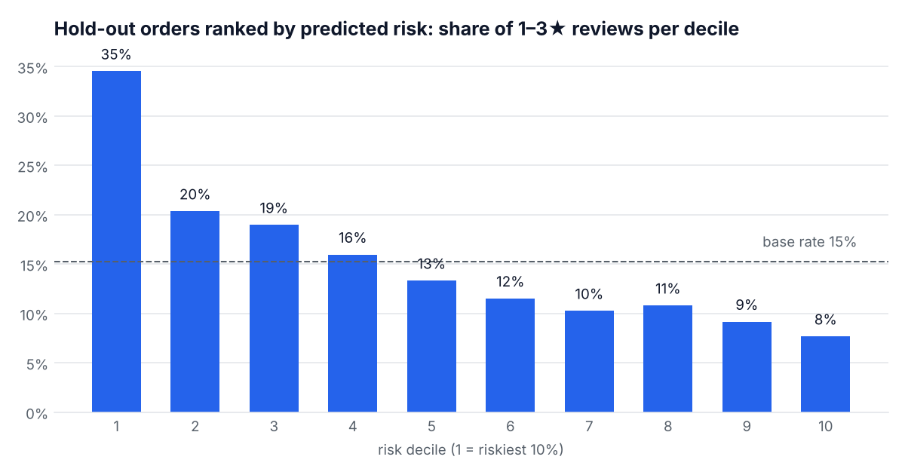
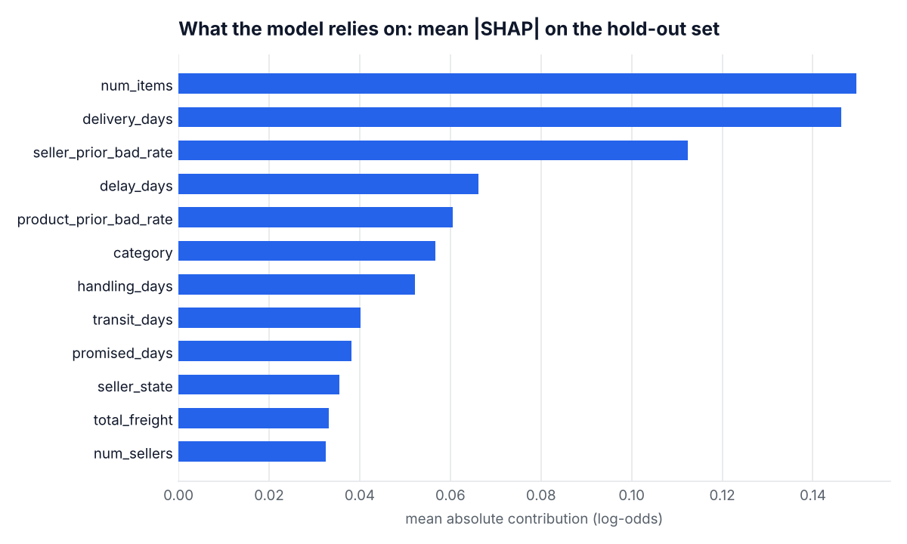
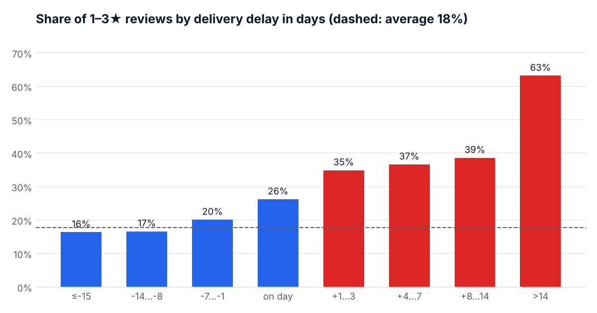

<picture>
  <source media="(prefers-color-scheme: dark)" srcset="./docs/assets/header-dark.svg">
  <source media="(prefers-color-scheme: light)" srcset="./docs/assets/header-light.svg">
  
</picture>

<p align="center">
  
  
  
  
  
  
</p>

**Can we tell, when a parcel is delivered, which customers are about to leave a 1–3★ review?** This project builds an end-to-end pipeline on the [Olist Brazilian e-commerce dataset](https://www.kaggle.com/datasets/olistbr/brazilian-ecommerce), about 100k orders from 2016–2018. Raw CSVs go into PostgreSQL, SQL builds a leak-free feature table, an XGBoost pipeline is tuned with Optuna, and a Streamlit dashboard explains each prediction with SHAP.

## 📊 Results

Hold-out set: the newest 18,235 orders (purchased 2018-05-31 to 2018-08-29), never touched during tuning. Base rate: 15% of these orders got 1–3★.

| model | ROC-AUC | PR-AUC | F1 | precision | recall | bad reviews in top 10% |
|---|---|---|---|---|---|---|
| logistic regression | 0.641 | 0.271 | 0.314 | 0.267 | 0.382 | 33.6% |
| random forest | 0.644 | 0.276 | 0.313 | 0.255 | 0.405 | 34.9% |
| **XGBoost (Optuna)** | **0.651** | **0.279** | **0.316** | 0.272 | 0.377 | **34.6%** |

<picture>
  <source media="(prefers-color-scheme: dark)" srcset="./reports/figures/deciles-dark.png">
  
</picture>

Read as a ranking, the model puts **2.3× more bad reviews** in its riskiest 10% than the base rate, and only half the base rate in its safest 10%. That is useful for deciding who support contacts first.
It is not a reliable verdict on any single order. A simple logistic regression gets close, which suggests the ceiling is in the data: most of what makes a customer unhappy (product quality, expectations) is not in delivery logs.

## 🔍 Leakage audit: why the first version looked better than it was

The first version reported **F1 ≈ 0.46**. Re-running it exactly turned up three problems:

1. **Reviews answered before delivery (temporal leakage).** Olist sends the review survey on the estimated delivery date if the parcel has not arrived by then. About 4.8k customers answered *before* their parcel arrived, and 89% of them gave 1–3★. For those orders, `delivery_days` and the delay are information from *after* the review, so the model was partly predicting complaints from the future. These rows are now excluded, because a model that scores orders at delivery cannot see them.
2. **Random train/test split.** Order patterns and the bad-review rate drift over time (15–20% per quarter, with a wave of late deliveries in early 2018). A random split mixes future orders into training. The evaluation now trains on older purchases and tests on the newest 20%.
3. **In-fold target encoding leak.** `category` was target-encoded once on the whole training set, then RFECV and Optuna cross-validated on it, so each validation fold had already seen its own labels. Every preprocessing step now lives in one scikit-learn `Pipeline`, re-fitted per fold. The encoder is sklearn's cross-fitted `TargetEncoder`.

| setup (original model) | test F1 | ROC-AUC | PR-AUC | base rate |
|---|---|---|---|---|
| as published: random split, includes pre-delivery reviews | 0.456 | 0.709 | 0.490 | 21% |
| without reviews answered before delivery | 0.354 | 0.647 | 0.289 | 18% |
| + temporal split | 0.288 | 0.625 | 0.248 | 15% |

Most of the original score came from leakage. The current model's numbers below are measured the honest way.

## 🧱 Pipeline

```text
Kaggle CSVs ──► ETL (pandas → PostgreSQL, one transaction, idempotent)
                   │
                   ▼
            sql/features_view.sql      one row per delivered order, only facts known at delivery
                   │                   + seller/product reputation as running totals (past reviews only)
                   ▼
            temporal split ──► Pipeline[ColumnTransformer(TargetEncoder, OneHot) → XGBoost]
                                   │   Optuna: 5-fold CV PR-AUC on the training part
                                   │   threshold: max F1 on out-of-fold predictions
                                   ▼
                     models/review_risk.joblib ──► Streamlit app (risk + SHAP drivers)
```

**Features** (30): basket (items, distinct products, **number of sellers**, price, freight, payment type and installments), main product (category, description and photo counts, weight, volume), geography (customer and seller state, same state), timeline (promised days, approval hours, seller handling and dispatch delay, carrier transit, delivery days, **days late**), and reputation (**the seller's and product's share of bad reviews before this delivery**).

Tree models are invariant to monotone transforms, so log transforms and quantile clipping were dropped from the XGBoost path. The logistic-regression baseline still gets log1p, imputation and scaling.

## 📈 What drives bad reviews

<picture>
  <source media="(prefers-color-scheme: dark)" srcset="./reports/figures/importance-dark.png">
  
</picture>

<picture>
  <source media="(prefers-color-scheme: dark)" srcset="./reports/figures/delay-dark.png">
  
</picture>

* **Delivery against the promise matters more than speed.** Early parcels sit at 16–17% bad reviews, while 1–14 days late jumps to 35–39%. After removing reviews answered before delivery, though, only 2% of orders are late, so lateness alone cannot find most unhappy customers.
* **Split shipments.** Orders with several items (33% bad with two items) and above all several **sellers** (60% with two sellers) do much worse, since each seller ships a separate parcel. `num_items` is the model's top feature.
* **Reputation carries over.** A seller's share of bad reviews *before* this delivery is the strongest signal that does not depend on the delivery itself: 13% bad for the best sellers and 26% for the worst.
* Category, delivery time and handling time add smaller effects. The [modelling notebook](notebooks/2_modelling.ipynb) has the full SHAP summary.

## 🚀 Reproduce

```bash
pip install -r requirements.txt            # requirements-dev.txt adds Jupyter, SHAP and pytest
docker compose up -d db                    # PostgreSQL 16 on localhost:5432 (or set DATABASE_URL in .env)
# download the Kaggle dataset and unzip all CSVs into data/
python -m olist_reviews.etl                # load raw tables and build features_view (~1 min)
python -m olist_reviews.train              # tune, evaluate, save models/review_risk.joblib (~15 min on CPU, --device cuda for GPU)
python -m olist_reviews.report             # regenerate the README figures
streamlit run app/streamlit_app.py
```

A trained model is committed, so the dashboard runs right after `pip install`, without the database. `pytest` runs fast unit tests on synthetic data, plus leakage checks against the database when it is available. One of them recomputes 200 sellers' reputation by brute force and compares it with the view.

## 🗂️ Repository

```
olist_reviews/   etl, features (load + temporal split), modeling (pipelines, Optuna, threshold), train, report
sql/             schema.sql (tables), features_view.sql (modelling table)
app/             Streamlit dashboard
notebooks/       1_eda (review timing, drift, signals), 2_modelling (hold-out evaluation, SHAP)
models/          review_risk.joblib (pipeline + threshold + app defaults)
reports/         metrics.json, figures/
tests/           pipeline unit tests, SQL leakage tests
```
